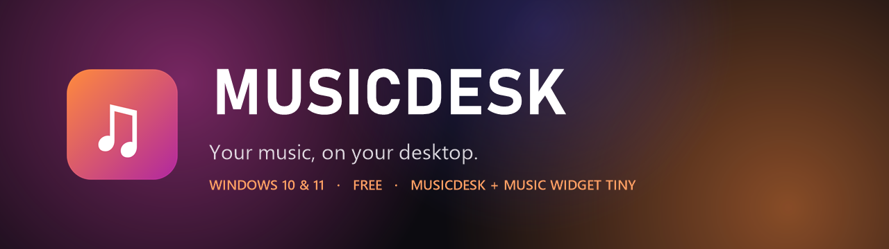
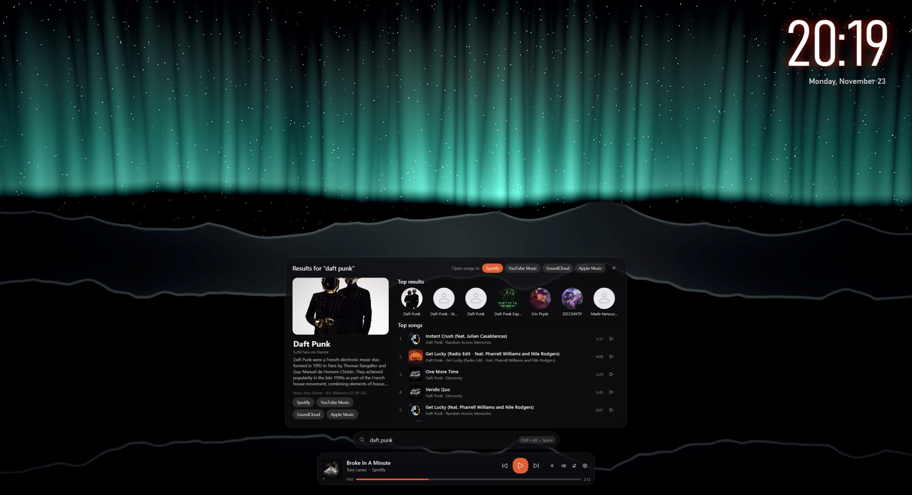
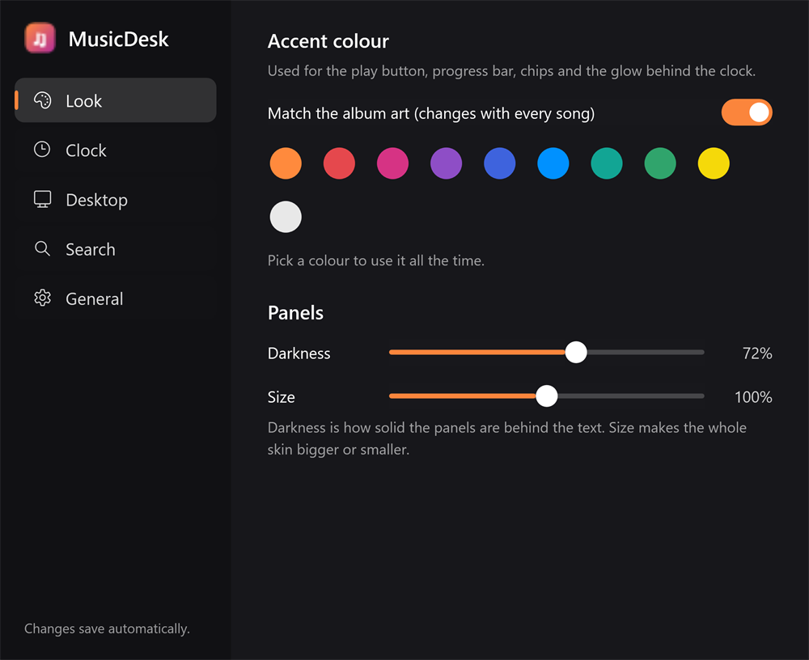
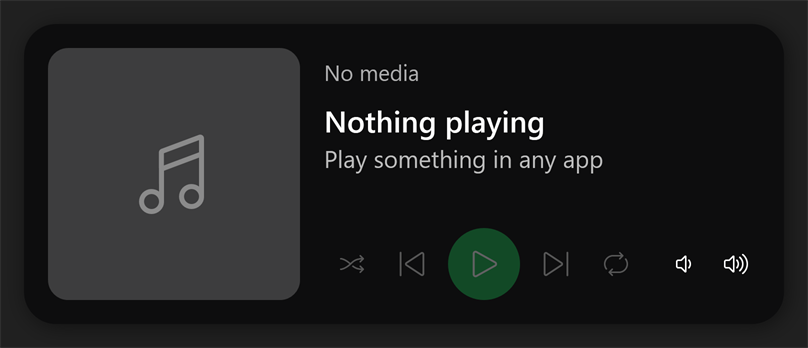
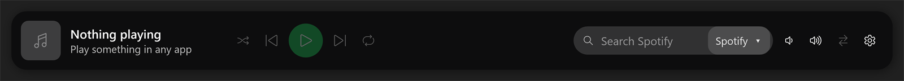
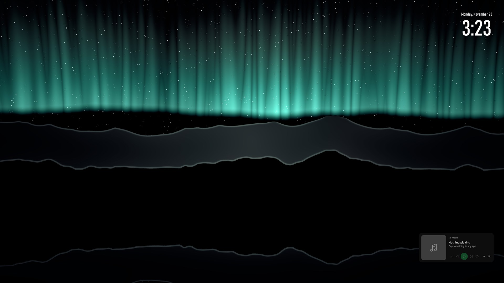
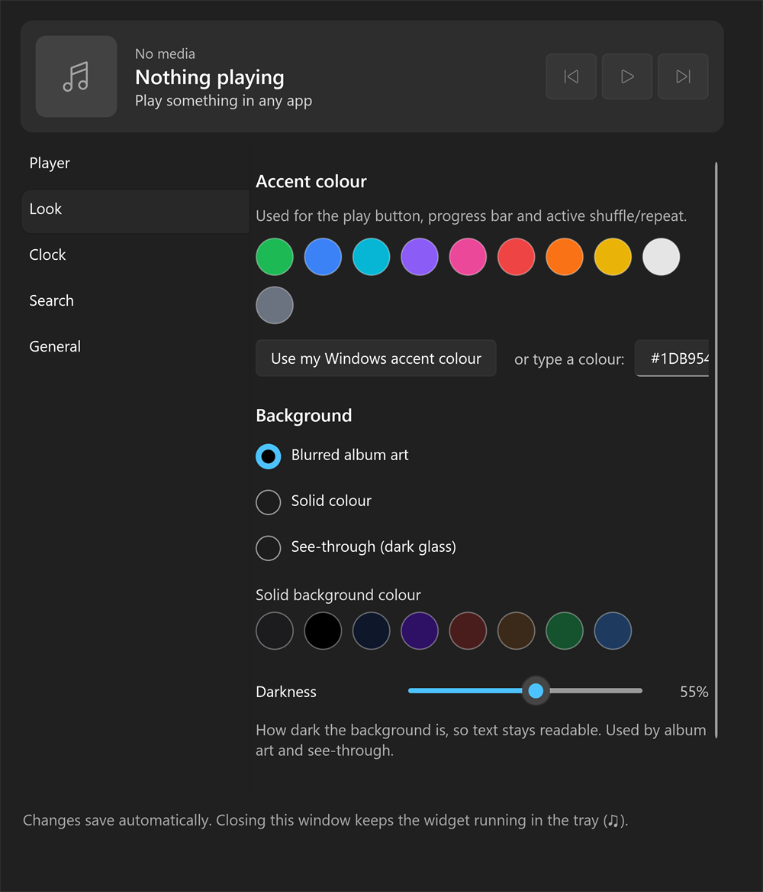

<p align="center">
  
</p>

<p align="center">
  <a href="https://github.com/withfires/musicdesk/releases/download/v1.0.0/MusicDesk-1.0.0.zip"></a>
  <a href="https://github.com/withfires/musicdesk/releases/download/v1.0.0/MusicWidgetTiny-2.0.0.zip"></a>
  <a href="https://musicdeskforpc.netlify.app/"></a>
</p>

<p align="center">
  Free music apps for Windows 10 and 11.<br>
  See what's playing, control it, and find any artist, right from your desktop.
</p>

<p align="center">
  
</p>

---

## Two apps, pick your style

<table>
  <tr>
    <th width="50%">MusicDesk</th>
    <th width="50%">Music Widget Tiny</th>
  </tr>
  <tr>
    <td>A full desktop skin. A big glowing clock, a now-playing bar and an artist search, sitting behind your windows like a wallpaper.</td>
    <td>Just the player. A small floating card or slim bar you can drag anywhere, with lots of style options.</td>
  </tr>
  <tr>
    <td align="center"><a href="https://github.com/withfires/musicdesk/releases/download/v1.0.0/MusicDesk-1.0.0.zip"><b>Download MusicDesk</b></a> · 6.2 MB</td>
    <td align="center"><a href="https://github.com/withfires/musicdesk/releases/download/v1.0.0/MusicWidgetTiny-2.0.0.zip"><b>Download Music Widget Tiny</b></a> · 6.2 MB</td>
  </tr>
</table>

---

## MusicDesk

- 🎵 **Controls any player.** Spotify, YouTube in your browser, Apple Music, VLC and anything else that uses Windows media controls. Play, pause, skip, seek and change volume.
- 🔍 **Find any artist.** Press <kbd>Ctrl</kbd> + <kbd>Alt</kbd> + <kbd>Space</kbd> anywhere, type a name, and get their photo, a short bio, similar artists and top songs with 30-second previews.
- 🎧 **Your platform, one click.** Open songs in Spotify, YouTube Music, SoundCloud or Apple Music.
- 🌈 **Colours follow the music.** The clock glow and buttons take their colour from the album cover.
- 🕘 **Recently played.** Every song you play lands in a list on the side.
- ⚙️ **Make it yours.** Pick an accent colour, panel darkness and size, 24-hour time, and hide the parts you don't need.

<p align="center">
  
</p>

## Music Widget Tiny

- 🃏 **Card or Bar style.** A compact card with cover art, or a slim bar along any edge.
- 🎨 **Style it.** Accent colour, blurred-cover, solid or see-through background, size and opacity.
- 🕒 **Optional desktop clock** with your choice of font, size, colour and 12 or 24-hour time.
- 🔎 **Search 9 platforms:** Spotify, YouTube Music, YouTube, Apple Music, SoundCloud, Deezer, TIDAL, Amazon Music and Genius.

<p align="center">
  
</p>
<p align="center">
  
</p>

<details>
<summary><b>More pictures of Music Widget Tiny</b></summary>
<br>
<p align="center"></p>
<p align="center"></p>
</details>

---

## Install

1. **Download** the zip above and unzip it (right-click → **Extract All**). Keep the folder somewhere permanent, like Documents.
2. **Open** `MusicDesk.exe` or `MusicWidget.exe`.
   - If Windows asks for the **.NET 9 Desktop Runtime**, install it from the link it shows (free, from Microsoft).
   - If Windows shows **"Windows protected your PC"**, click **More info** → **Run anyway**. Windows shows this for new apps it hasn't seen many times yet.
3. **Make it yours.** In MusicDesk, click the ⚙ gear on the player. In Music Widget Tiny, the settings open first.

## Verify your download

Only download these apps from this page or [the website](https://musicdeskforpc.netlify.app/). Copies from anywhere else may have been changed.

<details>
<summary>Check the SHA-256 fingerprint</summary>

Run this in PowerShell (use the name of the zip you downloaded):

```powershell
Get-FileHash "$env:USERPROFILE\Downloads\MusicDesk-1.0.0.zip" -Algorithm SHA256
```

The hash must match:

```
f0ed9494bc0c2daee06ba7c8b0897f551a3edb0d450c4d2c736b98e7d8b03bef  MusicDesk-1.0.0.zip
1196352dc326323f657e4923253fe5d780f6293a24d2db2ace84d75bf1144957  MusicWidgetTiny-2.0.0.zip
```

</details>

## License

© 2026 MusicDesk. All rights reserved. Free for personal use. Redistribution, resale, modification and reverse engineering are not permitted. See [LICENSE.txt](LICENSE.txt).

This repository only hosts official releases; the source code is not public. Music data and previews come from Deezer and artist bios from Wikipedia (CC BY-SA 4.0). Spotify, YouTube Music, SoundCloud and Apple Music are trademarks of their owners; MusicDesk is not affiliated with or endorsed by them.
